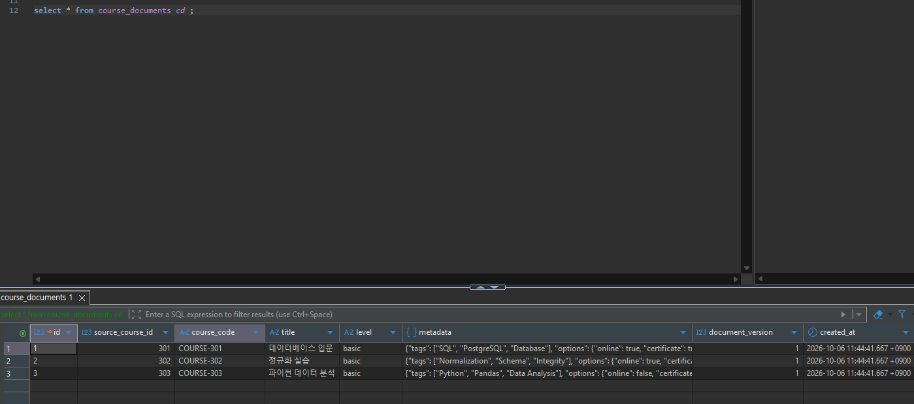
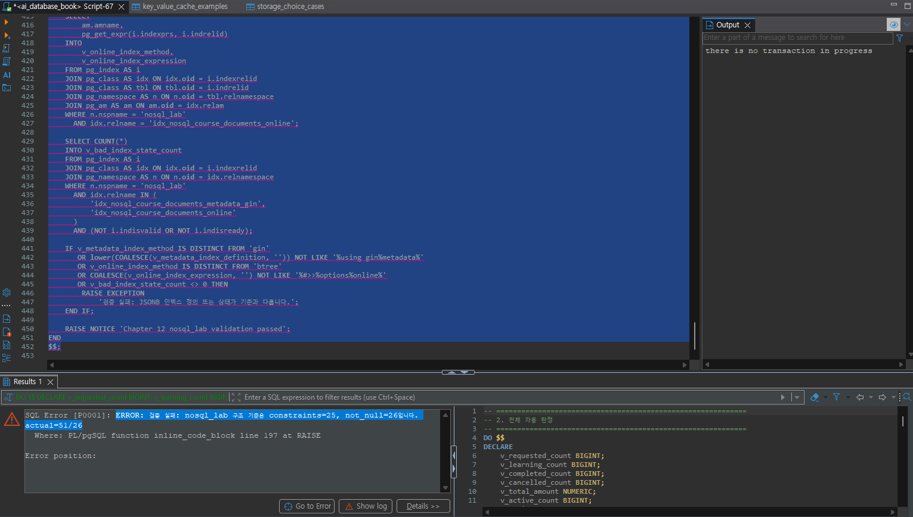

# Chapter 12 확장 실습 답안 템플릿

> **과제:** 조회 패턴으로 RDBMS와 NoSQL 선택하기  
> **사용 방법:** 이 파일을 내려받아 본인의 GitHub 저장소에 `chapter12_answer.md`라는 이름으로 저장한 뒤 실습하면서 바로 작성합니다.  
> **제출 방법:** LMS에는 파일을 직접 업로드하지 않고, **본인 GitHub 저장소의 `chapter12_answer.md` 파일 URL**을 제출합니다.

---

## 제출 전 주의

이 파일과 캡처 화면에는 실제 비밀번호, 전체 DB 접속 URL, API Key, 개인정보를 기록하지 않습니다.

```text
GitHub 계정 또는 별칭: koreajjangboy
과제 작성일: 2026-10-06
PostgreSQL 버전: PostgreSQL 18.6 on x86_64-windows, compiled by msvc-19.44.35228, 64-bit
사용한 AI 도구: Gemini
```

> 이번 장에서는 MongoDB, Redis, Cassandra, Graph DB 같은 별도 서버를 반드시 설치하지 않습니다.  
> 제공된 PostgreSQL `nosql_lab`을 이용해 **원본·파생·캐시·문서·저장소 선택 기준**을 실습합니다.

---

# 1. 시작 환경과 Chapter 07 기준 상태 확인

다음을 실행합니다.

```sql
SELECT current_database();
SELECT current_user;
SELECT current_schema();
SHOW search_path;
```

| 확인 항목 | 실제 결과 | 의미 |
| --- | --- | --- |
| `current_database()` | ai_database_book |  |
| `current_user` | postgres |  |
| `current_schema()` | public |  |
| `search_path` | "$user", public |  |

Chapter 07·08 기준 상태도 확인합니다.

```text
students = 3
instructors = 2
courses = 3
enrollments = 5

전체 recorded_amount = 590000
활성 = 3건 / 340000
취소 제외 = 4건 / 440000
```

### 기준 상태를 유지한 채 별도 `nosql_lab`에서 실습하는 이유

```text
1. RDBMS 메인 데이터 무결성 보존:
   - Chapter 07·08에서 검증된 기존 Relational Schema(수강생 3명, 강사 2명, 강좌 3개, 수강신청 5건 및 결제 수치)의 정합성을 원본 DB(Relational Store)에서 그대로 유지하기 위함입니다.

2. NoSQL 데이터 모델링 독립 실습:
   - RDBMS의 정규화(Normalized) 구조와 NoSQL의 비정규화/문서 중첩(Embedded Document / Key-Value) 모델 간의 차이를 독립된 실험 환경(nosql_lab)에서 자유롭게 비교·테스트하기 위함입니다.

3. 검증 수치(Ground Truth) 대조 기준 확보:
   - '전체 매출 590,000원 / 활성 3건(340,000원) / 취소 제외 4건(440,000원)'이라는 정답 수치를 기준선(Baseline)으로 두고, Document DB로 이관하거나 역정규화 조회를 수행했을 때 집계 결과가 원본과 오차 없이 일치하는지 검증하기 위함입니다.
```

---

# 2. 온라인 강의 데이터의 시스템 역할 분류

다음 데이터를 분류합니다.

| 데이터 | 시스템 역할 | Source of Truth 여부 | 잃어버리면 재구축 가능? | 이유 |
| --- | --- | --- | --- | --- |
| 수강신청 | Source of Truth | O | 불가능 | 거래 및 수강 권한의 원본 데이터로, 손실 시 복구할 수 없음 |
| 신청 당시 금액 | Source of Truth | O | 불가능 | 과거 특정 시점의 정산/결제 스냅샷으로, 가격 변동 시 재계산 불가능 |
| 로그인 세션 | Ephemeral State | X | 가능 (재로그인 필요) | 인증 유지를 위한 임시 상태 데이터로, 만료되거나 삭제돼도 재인증으로 생성 가능 |
| 인기 강의 TOP 3 | Derived Cache | X | 가능 | 원본 수강신청 및 조회 데이터를 바탕으로 언제든 재집계/재계산 가능 |
| 강의 태그/옵션 | Flexible Metadata | O | 불가능 | 강의 검색 및 분류를 위한 메타데이터의 원본으로, 손실 시 상품 정보 훼손 |
| 학습 행동 이벤트 | Event Log | O | 불가능 | 시계열로 발생하는 사용자의 불변(Immutable) 행동 기록 원본 데이터 |
| 추천 관계 | Relationship Index | X | 가능 | 사용자 행동 이벤트나 수강 데이터를 분석/지식 그래프화하여 파생 생성한 관계 인덱스 |

사용 가능한 역할 예:

```text
Source of Truth
Derived Cache
Ephemeral State
Flexible Metadata
Event Log
Relationship Index
```

### Source of Truth와 파생 저장소를 구분해야 하는 이유

```text
1. 장애 발생 시 데이터 신뢰성 확보 및 정합성 보장:
   - 시스템 장애나 데이터 불일치가 발생했을 때 어떤 저장소를 신뢰하고 복구 기준(Ground Truth)으로 삼을지 명확히 구분하기 위함입니다.

2. 데이터 백업 및 복구 전략의 효율화:
   - Source of Truth는 강력한 백업, 트랜잭션(ACID), 높은 가용성을 보장해야 하지만, Derived Cache나 Ephemeral State는 손실되어도 원본 데이터를 바탕으로 재생성(Rebuild)할 수 있으므로 비용과 리소스를 효율적으로 배분할 수 있습니다.

3. 데이터 변경의 단일 책임(Single Source of Truth) 원칙 준수:
   - 원본과 파생 데이터를 명확히 분리하지 않으면 파생 저장소의 데이터를 직접 수정하는 오류가 발생하여 원본과의 격차가 벌어지고 데이터 오염이 발생할 수 있습니다.
```

---

# 3. 저장소보다 먼저 조회·쓰기 패턴 정의

최소 6개의 읽기/쓰기 문장을 작성합니다.

| ID | 읽기/쓰기 문장 | 키/조건 | 정렬/범위 | 예상 빈도 | 일관성 요구 | 함께 원자적으로 맞아야 하는 데이터 |
| --- | --- | --- | --- | --- | --- | --- |
| Q01 | 학생 101의 최근 30일 학습 이벤트를 시간순으로 읽는다. | `student_id = 101` | 시간순 정렬 / 최근 30일 범위 | 높음 (초당 수십~수백 회) | 결과적 일관성 (Eventual) | 없음 (단일 이벤트 로그) |
| Q02 | `course:popular:v1:top3` 키로 인기 강의 3개를 읽는다. | Key = `course:popular:v1:top3` | 순위 정렬 / Top 3 | 매우 높음 (초당 수천 회) | 허용 (최대 5분 지연 허용) | 인기 강의 ID 리스트와 순위 수치 |
| Q03 | 강의 301의 태그와 온라인 제공 옵션을 읽는다. | `course_id = 301` | 없음 / 단일 강의 메타 데이터 | 높음 (초당 수백 회) | 강한 일관성 (Strong) 또는 높은 캐시 허용 | 강의 기본 정보와 옵션/태그 문맥 |
| Q04 | 학생과 강의의 수강신청을 하나의 트랜잭션으로 확정한다. | `student_id`, `course_id` | 없음 / 단일 생성 쓰기 | 중간 (이벤트/프로모션 시 급증) | 절대적 강한 일관성 (ACID) | 수강신청 건, 결제/신청 금액, 수강 인원 잔여 수량 |
| Q05 | 학생 A와 관심 주제가 가까운 강의를 2~3단계 관계로 탐색한다. | `student_id = A` | 연관도/가까움 순 / 2~3 Hop 관계 깊이 | 보통 (초당 수십 회) | 결과적 일관성 (Eventual) | 학생-주제 관계, 주제-강의 관계 그래프 데이터 |
| Q06 | 로그인한 사용자 B의 현재 세션 정보를 확인한다. | Key = `session:user_b_token` | 없음 / 단일 키 조회 | 매우 높음 (모든 API 요청 시) | 강한 일관성 (Strong) | 사용자 ID, 만료 시간, 권한 정보 |

### 기술 이름보다 조회 패턴을 먼저 작성해야 하는 이유

```text
1. 오버엔지니어링 및 잘못된 DBMS 선정 방지:
   - "Redis를 쓰자" 또는 "MongoDB를 쓰자"처럼 특정 기술을 먼저 결정하면, 실제 서비스의 트랜잭션 범위, 데이터 읽기/쓰기 비율, 정렬 요구사항과 맞지 않는 불필요한 복잡성이 발생할 수 있습니다.

2. 데이터 일관성(Consistency)과 성능(Latency) 간의 명확한 Trade-off 평가:
   - 결제/수강신청처럼 '원자적 트랜잭션(Strong Consistency)'이 필수인 패턴과 인기 강의 TOP 3처럼 '지연 응답(Eventual Consistency)'을 허용하는 패턴을 미리 구분해야 적합한 저장소 구조와 캐싱 전략을 설계할 수 있습니다.

3. 데이터베이스 인덱싱 및 데이터 모델링(Access Pattern First) 기준 확립:
   - NoSQL 및 비정규화 데이터베이스는 '조회 패턴(Access Pattern)'에 맞춰 데이터를 구조화해야 하므로, 읽기/쓰기 문장과 조건, 정렬 범위를 정의하는 것이 모델링의 출발점이 됩니다.
```

---

# 4. `nosql_lab` 생성과 기준 데이터 확인

다음 파일을 순서대로 실행합니다.

```text
code/chapter12/01_nosql_lab_schema.sql
code/chapter12/02_nosql_lab_seed.sql
```

## 4-1. 기준 행 수

| 테이블 | 기대 행 수 | 실제 행 수 | 일치? |
| --- | ---: | ---: | --- |
| `nosql_lab.course_documents` | 3 |  |  |
| `nosql_lab.key_value_cache_examples` | 4 |  |  |
| `nosql_lab.storage_choice_cases` | 6 |  |  |

## 4-2. 원본 매핑 확인

| source_course_id | 기대 course_code | 실제 title | 원본과 일치? |
| ---: | --- | --- | --- |
| 301 | `COURSE-301` |  |  |
| 302 | `COURSE-302` |  |  |
| 303 | `COURSE-303` |  |  |

### 증거 화면

권장 경로:

```text
assignments/chapter12/images/step04_nosql_lab.png
```

`여기에 nosql_lab 기준 상태 확인 화면을 삽입하세요.`

---

# 5. PostgreSQL JSONB 혼합 문서 실습

다음을 실행합니다.

```text
code/chapter12/03_document_jsonb_queries.sql
```

## 5-1. 일반 컬럼과 JSONB 영역 구분

| 항목 | 일반 컬럼 / JSONB | 그렇게 둔 이유 |
| --- | --- | --- |
| `source_course_id` | 일반 컬럼 | RDBMS 원본 데이터와의 식별 및 명확한 조인/대조를 위한 안정적인 식별자 |
| `course_code` | 일반 컬럼 | UNIQUE 제약조건 및 B-Tree 인덱스 기반의 빠른 키 조회가 필수적인 핵심 식별자 |
| `title` | 일반 컬럼 | 필수 검색 및 조회 조건이며 NOT NULL, NOT BLANK 제약조건으로 정합성을 보장해야 함 |
| `level` | 일반 컬럼 | 도메인 범위(`basic`, `intermediate`, `advanced`)가 명확하여 CHECK 제약조건으로 강제해야 하는 핵심 속성 |
| `document_version` | 일반 컬럼 | 동시성 제어(낙관적 잠금) 시 조건절 검색 및 버전 증가 연산을 직관적이고 빠르게 수행하기 위함 |
| `tags` | JSONB | 강의마다 개수와 종류가 유연하게 변하며, 다중 요소 검색(`@>`)에 적합한 가변 메타데이터 |
| `options` | JSONB | `online`, `certificate` 등 향후 새로운 옵션 속성이 추가·변경되더라도 스키마 변경 없이 유연하게 확장하기 위함 |
| `instructor_snapshot` | JSONB | 화면 표시 속도 향상을 위한 비정규화 파생 데이터로, 원본 변경과 독립된 조회용 스냅샷 구조 |

### `level`을 JSONB 안에 넣지 않고 일반 컬럼으로 둔 이유

```text
1. 명확한 데이터 범위 제약 및 무결성 보장:
   - level은 'basic', 'intermediate', 'advanced'로 도메인이 고정되어 있으므로, DB 차원에서 CHECK 제약조건을 통해 유효하지 않은 값이 들어오는 것을 완벽히 차단하기 위함입니다.

2. 검색 및 인덱싱 성능 최적화:
   - level은 난이도별 강의 목록 조회나 필터링 조건으로 자주 사용되는 핵심 속성이므로, JSONB 내부 경로 접근 연산(->>)에 비해 일반 컬럼 및 B-Tree 인덱스를 통한 조회가 훨씬 빠르고 효율적입니다.

3. 데이터 모델링의 원칙 (안정적 속성과 가변 속성의 분리):
   - 강의의 난이도는 문서 구조의 변화와 관계없이 모든 강의가 필수적으로 가져야 하는 안정된(Stable) 핵심 속성이므로 일반 컬럼에 두고, 가변적이거나 확장되는 메타데이터만 JSONB 영역으로 분리하는 것이 바람직합니다.
```

### `instructor_snapshot`이 Source of Truth가 아닌 이유

```text
1. 원본 데이터(Relational Store)의 존재:
   - 강사 이름, 전공, 이메일 등의 실제 원본 정보는 `course_project.instructors` 테이블(RDBMS)에 존재하며, `instructor_snapshot`은 조회 성능 최적화를 위해 복사해 온 파생 데이터(Derived/Denormalized Snapshot)에 불과합니다.

2. 데이터 불일치(Stale Data) 및 동기화 필요성:
   - 원본 강사 정보가 변경(예: 이름 변경, 이메일 수정)되더라도 `instructor_snapshot`에 즉시 반영되지 않고 과거 특정 시점(`copied_at`)의 정보로 남아있게 되므로, 데이터 정합성의 기준점이 될 수 없습니다.

3. 재구축(Rebuild) 가능성:
   - `course_documents` 내부의 `instructor_snapshot` 데이터가 손실되거나 오염되더라도, `source_instructor_id`를 기반으로 원본 `instructors` 테이블을 재조회하면 언제든지 동일한 스냅샷을 100% 다시 생성할 수 있습니다.
```

## 5-2. JSONB 조회 결과

```text
사용한 JSONB 조건: metadata @> '{"tags": ["PostgreSQL"]}'::jsonb
예상 결과: COURSE-301 (1건)
실제 결과: COURSE-301 (1건)
```

```sql
SELECT
    source_course_id,
    course_code,
    title
FROM nosql_lab.course_documents
WHERE metadata @> '{"tags": ["PostgreSQL"]}'::jsonb;
```

## 5-3. 낙관적 잠금 관찰

```text
읽은 document_version: 1
UPDATE 조건에 사용한 version: 1
예상 영향 행 수: 1
실제 영향 행 수: 1
```

### 영향 행 수가 0이면 무엇을 의심해야 하나요?

```text
1. 동시성 충돌 (Concurrent Update Collision):
   - 다른 트랜잭션이나 사용자가 내가 데이터를 읽은 시점 이후에 해당 문서를 먼저 수정하여 `document_version`이 이미 변경되었을 수 있습니다.

2. 수정 대상 키/경로 조건 불일치:
   - UPDATE 조건절에 포함된 JSONB 경로 검증 조건(예: `jsonb_typeof(metadata -> 'options') = 'object'`)을 만족하지 않거나 대상 `course_code` 키가 존재하지 않을 수 있습니다.

3. 데이터 미존재 또는 삭제:
   - 조회한 대상 데이터가 UPDATE 실행 직전에 다른 프로세스에 의해 삭제되었을 가능성이 있습니다.
```

### 실습에서 ROLLBACK 후 기준 상태를 유지하는 이유

```text
1. 후속 실습 환경의 멱등성(Idempotency) 보장:
   - 이후 스크립트나 실습을 반복 실행할 때 기준 데이터의 `document_version`이나 값이 변경되면 예상치 못한 검증 오류가 발생하므로 초기 기준 상태(Baseline)를 동일하게 유지하기 위함입니다.

2. 데이터 정합성 검증 원칙 준수:
   - 테스트용 수정 트랜잭션의 동작 결과만 확인한 뒤, 원본 샌드박스 데이터세트를 오염시키지 않고 원래 상태로 안전하게 복구(Rollback)하는 습관을 형성하기 위함입니다.
```

---

# 6. Key-Value 캐시 개념 실습

다음을 실행합니다.

```text
code/chapter12/04_key_value_cache_queries.sql
```

## 6-1. Seed 기준

```text
전체 캐시 = 4
Seed 시점 유효 = 3
Seed 시점 만료 = 1
```

| 항목 | 기대 | 실제 |
| --- | ---: | ---: |
| 전체 | 4 | 4 |
| Seed 시점 유효 | 3 | 3 |
| Seed 시점 만료 | 1 | 1 |

## 6-2. Seed 기준과 현재 시각 기준 차이

```text
현재 유효 캐시 수: 0건 (또는 시점에 따른 실행 수치)
```

### 현재 유효 건수를 고정 정답으로 사용하면 안 되는 이유

```text
1. 시간 경과에 따른 가변성:
   - TTL(Time To Live)이 지정된 캐시 데이터는 시간의 흐름(CURRENT_TIMESTAMP)에 따라 자연스럽게 만료 상태로 전환되므로, 쿼리를 실행하는 시점에 따라 유효 건수가 동적으로 변하기 때문입니다.

2. 테스트 멱등성 보장 불가:
   - 특정 시간 기준의 결과값(예: '3건')을 정답으로 고정해 두면, 시간이 지난 후 실습 스크립트를 재실행했을 때 만료 처리되어 테스트 및 자동 검증이 실패하게 됩니다.
```

## 6-3. 정확 키 조회

```text
조회한 키: course:301:summary
결과: 조회 성공
캐시 미스 여부: 만료 전 - 캐시 히트(Cache Hit) / 만료 후 - 캐시 미스(Cache Miss)
```

### Key-Value 제품의 TTL과 eviction을 같은 개념으로 보면 안 되는 이유

```text
1. TTL (Time To Live / 시간 기반 만료):
   - 데이터 생성 시 지정된 '유효 수명'이 지나면 해당 데이터가 논리적/물리적으로 만료되어 사용할 수 없게 되는 '시간 기준' 삭제 메커니즘입니다.

2. Eviction (축출 / 메모리 확보를 위한 강제 삭제):
   - 메모리 한계(Max Memory Limit)에 도달했을 때, 아직 TTL이 남아 유효한 데이터라 할지라도 LRU, LFU 등의 알고리즘 정책에 따라 메모리를 확보하기 위해 우선 제거하는 '공간/메모리 기준' 삭제 메커니즘입니다.
```

### 이 PostgreSQL 테이블이 실제 Redis 같은 Key-Value DB가 아닌 이유

```text
1. 저장 매체 및 성능 차이 (In-Memory vs Disk):
   - Redis는 데이터를 메모리(RAM)에 저장하여 마이크로초 단위의 초고속 I/O를 제공하는 반면, PostgreSQL은 기본적으로 디스크 기반 RDBMS 기반 구조를 가집니다.

2. 자동 TTL/Eviction 백그라운드 프로세스 부재:
   - Redis는 만료된 키를 백그라운드 태스크로 자동 삭제(Passive/Active Expiration)하고 메모리 초과 시 Eviction을 수행하지만, PostgreSQL 테이블은 SELECT 시점에 조건을 비교하거나 직접 DELETE 쿼리를 실행하기 전까지 디스크에 데이터가 그대로 남아있습니다.

3. 데이터 구조 및 전용 프로토콜 미지원:
   - Redis는 Key-Value 조회를 최적화한 전용 싱글 스레드 이벤트 루프 아키텍처 및 다양한 인메모리 자료구조(Hashes, Sets, Sorted Sets 등)와 전용 프로토콜(RESP)을 지원하는 반면, 본 테이블은 RDBMS 상에서 Key-Value 형태를 유연하게 스키마로 흉내 낸 구조에 불과합니다.
```

---

# 7. 캐시 장애 사고 실험

상황:

```text
PostgreSQL 원본에서는 인기 강의 순위가 변경되었다.
캐시에는 이전 TOP 3가 남아 있다.
```

다음에 답합니다.

```text
신뢰해야 할 원본: PostgreSQL 데이터베이스 (RDBMS 원본 테이블)
사용자에게 오래된 값을 허용할 수 있는 시간: 설정된 TTL 범위 내 (예: 5분~1시간 내외, 서비스 비즈니스 요구사항에 따라 결정)
캐시 갱신 방식: Cache-Aside (Look-Aside) 및 Write-Through 또는 원본 변경 시 캐시 무효화(Cache Invalidation)
캐시 삭제 후 재생성 방법: 원본 DB 데이터 변경(UPDATE/DELETE) 발생 시 해당 캐시 키를 Explicit Delete하고, 이후 첫 조회 시 DB에서 읽어와 캐시에 재적재(Lazy Loading)
캐시 서버 장애 시 fallback: DB 직접 조회(DB Direct Query)로 전환하여 서비스 연속성 유지 (단, DB 부하 방지를 위한 Circuit Breaker 또는 Rate Limiting 적용)
동시 재생성 요청이 몰릴 때의 위험: 캐시 스탬피드(Cache Stampede / Thundering Herd Problem) 발생으로 인한 DB 순간 부하 급증 및 서버 다운
```

### 캐시가 Source of Truth가 되어서는 안 되는 이유

```text
1. 휘발성 및 데이터 손실 위험 (Volatiles / Data Loss):
   - 캐시 시스템(Redis, Memcached 등)은 주로 인메모리(RAM) 기반으로 동작하므로, 프로세스 재시작, 서버 장애, OOM(Out of Memory) 등으로 인해 데이터가 언제든지 유실될 수 있습니다.

2. 비영속성 및 백업/트랜잭션 미지원:
   - RDBMS와 달리 완전한 ACID 트랜잭션, 복구 로그(WAL), 엄격한 제약조건(PK/FK/CHECK)을 보장하지 않아 데이터의 절대적인 정합성과 영속성(Durability)을 담보할 수 없습니다.

3. 데이터 동기화의 기준점(Base Line) 부재:
   - 캐시는 성능 향상을 위해 원본 데이터를 일시적으로 복사해 둔 파생 데이터 저장소이므로, 캐시를 기준으로 삼을 경우 데이터 불일치(Stale Data) 발생 시 최종 진위 여부를 판가름할 수 없게 됩니다.
```

---

# 8. 저장 방식 선택 사례 검토

다음을 실행합니다.

code/chapter12/05_storage_choice_review.sql

각 사례에서 최소 다음 정보를 확인합니다.

| 사례 | system_role | primary_query | 후보 저장소 | consistency | sync 전략 | recovery 전략 | decision_status |
| --- | --- | --- | --- | --- | --- | --- | --- |
| 1 | source_of_truth | 수강신청/결제 트랜잭션 처리 | PostgreSQL (RDBMS) | Strong (ACID) | N/A (원본 저장소) | WAL 기반 PITR 복구 | adopted |
| 2 | ephemeral_state | 사용자 분당 요청 수 계산 및 제한 | Redis (In-Memory) | Eventual | Sync/Async 적재 | 만료 후 자동 재생성 | candidate |
| 3 | derived_cache | 실시간 인기 강의 Top 10 조회 | Redis (In-Memory) | Eventual | Cache-Aside (Look-Aside) | DB 기반 Cache Rebuild | poc_planned |
| 4 | flexible_metadata | 강의별 가변 옵션 및 문서 조회 | PostgreSQL JSONB | Eventual/Strong | 앱 레이어 문서 갱신 | PostgreSQL 백업/복구 | candidate |
| 5 | event_log | 학습 진행률 이벤트 시퀀스 기록 | MongoDB / ClickHouse | Eventual | Async Event Publisher | 메시지 큐 기반 재처리 | hold |
| 6 | relationship_index | 수강생-강사-강의 연관관계 그래프 조회 | Neo4j (Graph DB) | Eventual | CDC / Event Streaming | RDBMS 원본 기반 Re-index | poc_planned |

결정 상태:

candidate
poc_planned
hold
adopted
rejected

### 후보 저장소와 실제 채택을 구분해야 하는 이유

1. 시스템 도입 위험 극소화 (PoC 및 검증 단계 필요):
   - 특정 기술이나 NoSQL 저장소가 이론상 적합해 보이더라도, 실제 운영 환경에서의 성능, 정합성, 백업/복구, 운영 공수 등을 PoC(개념 검증)를 통해 검증하기 전에 섣불리 채택하면 장애 위험이 커지기 때문입니다.

2. 기술 부채 및 아키텍처 복잡도 관리:
   - 후보 저장소를 모두 즉시 도입할 경우 데이터베이스 인프라 파편화와 동기화 복잡도가 급증하므로, 명확한 도입 근거와 성공 기준(PoC Criteria)을 충족한 경우에만 최종 채택(adopted)하여 기술 부채를 방지해야 합니다.

### 현재 데이터에서 `adopted`가 PostgreSQL 원본 1건뿐인 이유를 자신의 말로 설명

1. 단일 진실 공급원(Source of Truth)의 검증 완료:
   - 시스템의 핵심인 수강신청/결제 트랜잭션 및 강한 정합성(ACID)은 이미 PostgreSQL을 통해 기능과 안정성이 완벽히 검증되어 채택(adopted)된 상태입니다.

2. 파생 및 신규 저장소의 검증 절차 진행 중:
   - Redis, MongoDB, Neo4j 등 나머지 5개 캐시/NoSQL 사례는 RDBMS 원본 데이터를 보조하거나 성능을 향상시키기 위한 '파생 저장소' 단계로, 아키텍처 적합성 검토(candidate), 테스트 계획(poc_planned), 또는 도입 보류(hold) 상태에서 검증 과정을 거치는 중이기 때문입니다.

---

# 9. 저장 모델 비교표

제품 이름보다 저장 모델을 비교합니다.

| 후보 | 잘 맞는 접근 패턴 | 트랜잭션/일관성 고려 | 재구축 가능성 | 운영·보안·백업 부담 | 현재 판단 |
| --- | --- | --- | --- | --- | --- |
| PostgreSQL RDBMS | 복잡한 관계 조회, 결제/수강신청 등 명확한 스키마 기반 CRUD | Strong Consistency (ACID 보장) | 원본 저장소 (재구축 불가) | 기존 DB 운영 인프라 활용 (추가 부담 없음) | adopted (최종 채택) |
| PostgreSQL JSONB | 강의별 가변 옵션, 메타데이터 문서 및 키-값 혼합 조회 | Strong / Eventual | 원본 기반 재구성 가능 | 동일 RDBMS 관리 (추가 인프라 부담 없음) | candidate (후보) |
| Key-Value | 키 기반 초고속 단건 조회, 세션/임시 상태/캐시 관리 | Eventual Consistency | 원본 RDBMS 기반 재적재 가능 | 메모리 관리, TTL 정책, Eviction 설정 필요 | candidate / poc_planned |
| Document | 유연한 문서 구조 저장, 이벤트 시퀀스 및 로그 기록 | Eventual Consistency | 원본 메시지/로그 재처리를 통해 재구성 가능 | 별도 Cluster, Sharding, ReplicaSet 관리 필요 | hold (보류) |
| Column-Family | 대용량 시계열/이벤트 데이터의 고성능 쓰기 및 집계 | Eventual Consistency | 원본 이벤트 스트림으로 재구성 가능 | 대규모 노드 관리, 스키마 컴팩션 운영 필요 | hold (보류) |
| Graph | 강사-수강생-강의 간 다대다 연관관계 탐색 및 추천 | Eventual Consistency | RDBMS 원본 데이터 기반 재인덱싱 가능 | 전용 그래프 DB 인프라, CDC 동기화 파이프라인 관리 | poc_planned |

### “NoSQL은 항상 더 빠르다”가 잘못된 설명인 이유

1. Access Pattern 및 쿼리 복잡도 차이:
   - NoSQL은 PK/Key 기반 단건 조회나 단순 읽기/쓰기에는 매우 빠르지만, 복잡한 Join, 다중 조건 집계, 트랜잭션 정합성이 필요한 상황에서는 오히려 RDBMS보다 성능이 떨어지거나 처리가 불가능합니다.

2. 데이터 크기 및 메모리/인덱스 구조의 영향:
   - 데이터가 디스크 I/O 제한에 걸리거나 인덱스가 효율적으로 타지 않는 구조라면 NoSQL이라 하더라도 성능이 저하되며, RDBMS도 Proper Indexing 및 In-Memory Caching(Buffer Pool)을 활용하면 동일한 빠른 성능을 제공합니다.

3. 데이터 정합성 보장 비용:
   - NoSQL에서 강한 일관성을 요구하도록 애플리케이션 단에서 복잡한 로직이나 락(Lock)을 구현하면, DB 차원에서 트랜잭션을 처리하는 RDBMS보다 훨씬 느려질 수 있습니다.

### 저장소가 하나 추가될 때 새로 생기는 운영 책임 최소 5개

1. 백업 및 시점 복구(PITR) 전략 수립 및 백업 검증 책임
2. 데이터 동기화 지연(Replication/Sync Lag) 감시 및 정합성 복구 책임
3. 신규 저장소 전용 모니터링, 알림(Alerting) 및 장애 조치(Failover) 체계 구축
4. 보안 정책(계정, 권한, 암호화) 관리 및 패치/업그레이드 운영 책임
5. 인프라 비용 관리 및 Capacity Planning (메모리, 디스크 확장성) 책임

---

# 10. JSONB 인덱스 후보 관찰

다음을 실행합니다.

code/chapter12/06_jsonb_index_candidates.sql

본문 후보:

metadata @> ...
→ GIN 후보

metadata #>> '{options,online}' = 'true'
→ 표현식 B-tree 후보

## 10-1. 생성된 인덱스

| 인덱스 | 대상 표현식/컬럼 | 대응 조회 | 실제 정의 확인 |
| --- | --- | --- | --- |
| idx_nosql_course_documents_metadata_gin | metadata | metadata @> '{"tags": ["PostgreSQL"]}'::jsonb | CREATE INDEX idx_nosql_course_documents_metadata_gin ON nosql_lab.course_documents USING gin (metadata) |
| idx_nosql_course_documents_online | (metadata #>> '{options,online}') | metadata #>> '{options,online}' = 'true' | CREATE INDEX idx_nosql_course_documents_online ON nosql_lab.course_documents USING btree (((metadata #>> '{options,online}'))) |

### 데이터가 3행뿐이라 인덱스가 있어도 Seq Scan이 합리적일 수 있는 이유

1. 디스크 I/O 최적화 (Cost-based Optimizer 판단):
   - 행 수가 매우 적은(3행) 경우, 인덱스 블록을 읽고 다시 테이블 데이터 블록을 찾는 Index Scan 과정보다 테이블의 1~2개 블록을 직접 순차 탐색(Seq Scan)하는 편이 I/O 및 CPU 계산 비용 면에서 훨씬 효율적이기 때문입니다.

### `jsonb_ops`와 `jsonb_path_ops`를 무조건 같은 것으로 보면 안 되는 이유

1. 지원하는 연산자 범주의 차이:
   - 기본 연산자 클래스인 `jsonb_ops`는 포함 연산자(`@>`)뿐만 아니라 최상위 키 존재 연산자(`?`, `?|`, `?&`)를 지원하지만, `jsonb_path_ops`는 포함 연산자(`@>`) 및 JSON Path 연산만 지원하고 `?` 키 존재 연산자는 지원하지 않습니다.

2. 인덱스 크기 및 성능 차이:
   - `jsonb_path_ops`는 경로와 값의 해시(Hash) 조합만 저장하므로 `jsonb_ops`에 비해 인덱스 용량이 훨씬 작고 포함 검색 성능이 더 뛰어납니다. 따라서 사용하려는 질의 패턴에 맞게 올바른 연산자 클래스를 선택해야 합니다.

---

# 11. 최종 자동 검증

다음을 실행합니다.

```text
code/chapter12/07_nosql_lab_validation.sql
```

기대 메시지:

```text
Chapter 12 nosql_lab validation passed
```

```text
실제 검증 메시지: ERROR: 검증 실패: nosql_lab 구조 기준은 constraints=25, not_null=26입니다. actual=51/26
```

검증되는 주요 내용:

```text
Chapter 07 기준 상태 유지
nosql_lab = 3 / 4 / 6
강의 301~303 원본 매핑
instructor_snapshot 원본 대조
JSONB 구조와 document_version 기준 유지
Seed 캐시 = 4 / 3 / 1
저장소 선택 근거 공백 0
adopted 사례 1
JSONB 인덱스 정의
```

### 자동 검증이 통과해도 저장소 선택이 자동으로 정답이 되는 것은 아닌 이유

```text
1. 비즈니스 맥락 및 도메인 요구사항의 복잡성:
   - 자동 검증 스크립트는 기술적인 데이터 구조, 제약조건, 특정 쿼리의 실행 여부 및 정합성(Value matching)만을 판단합니다.
   - 반면 실제 저장소 선택은 비즈니스의 성장 가능성, 데이터 읽기/쓰기 트래픽 패턴, 가용성 요구수준(SLA), 팀 내 기술 숙련도 등 다차원적인 맥락을 종합하여 판단해야 하므로 코드상의 유효성 검증만으로 최적의 선택임을 보장할 수 없습니다.

2. 비기능적 요인 및 운영 비용(Total Cost of Ownership)의 미반영:
   - 검증 스크립트는 쿼리 결과의 유무만 판별할 뿐, 실제 인프라 운영 부담, 백업/복구 복잡도, 데이터 동기화 지연, 모니터링 체계, 비용 효율성 등 NoSQL 도입 시 발생하는 실질적인 운영 위험 요소를 검증하지 못합니다.
```

### 증거 화면

권장 경로:

```text
assignments/chapter12/images/step11_validation.png
```

`여기에 최종 검증 통과 화면을 삽입하세요.`

---

# 12. 개인 프로젝트의 데이터 역할 분류

Chapter 07부터 발전시킨 개인 프로젝트를 사용합니다.

최소 6개 데이터 항목을 분류합니다.

| 데이터 | 시스템 역할 | Source of Truth? | 대표 조회/쓰기 | 트랜잭션 필요? | 재구축 가능? | 저장소 후보 |
| --- | --- | --- | --- | --- | --- | --- |
| 수강생 (students) | source_of_truth | 예 | 수강생 프로필 조회 및 회원가입 | 예 | 아니오 (원본) | PostgreSQL RDBMS |
| 강의 (courses) | source_of_truth | 예 | 강의 목록 및 상세 정보 조회/수정 | 예 | 아니오 (원본) | PostgreSQL RDBMS |
| 수강신청/결제 (enrollments) | source_of_truth | 예 | 수강 신청 및 수강 상태 변경, 금액 기록 | 예 | 아니오 (원본) | PostgreSQL RDBMS |
| 강의 문서 (course_documents) | read_model | 아니오 | 옵션별 강의 검색 (`metadata @>`) | 아니오 | 예 (RDBMS에서 생성) | PostgreSQL JSONB |
| 인기 강의 캐시 (popular_courses) | read_model / cache | 아니오 | 홈 화면 TOP 3 인기 강의 초고속 조회 | 아니오 | 예 (RDBMS에서 집계) | Key-Value (Redis) |
| 사용자 세션 (user_session) | transient_state | 아니오 | 요청별 사용자 인증 토큰/세션 검증 | 아니오 | 예 (재로그인으로 대체) | Key-Value (Redis) |

---

# 13. 개인 프로젝트 저장 전략 결정

## 13-1. Source of Truth

```text
내 프로젝트의 Source of Truth:
PostgreSQL RDBMS (course_project 스키마의 students, instructors, courses, enrollments 테이블)

그 이유:
수강 신청 및 결제 정보(recorded_amount) 등 핵심 비즈니스 데이터는 엄격한 ACID 트랜잭션과 외래키(FK), NOT NULL, UNIQUE 제약조건을 통해 데이터 정합성을 완벽히 보장해야 하며, 손실 시 복구가 불가능한 원본 데이터이기 때문입니다.
```

## 13-2. PostgreSQL만 유지할지, 다른 저장 모델을 검토할지

```text
현재 결정:
PostgreSQL만 사용 (필요시 PostgreSQL 내부 JSONB 활용)
```

### 결정 근거

```text
주요 조회 패턴:
수강생/강의 CRUD, 수강 신청/상태 변경, 옵션별 강의 조건 검색 등 관계형 조인과 스키마 기반 조회가 주를 이룸.

일관성 요구:
수강 신청 및 금액 기록은 Strong Consistency(강한 일관성)가 필수적임.

파생 데이터 여부:
캐시 및 JSONB 검색용 문서는 모두 RDBMS 원본 데이터로부터 언제든 재구성 가능함.

재구축 가능 여부:
원천 데이터(Source of Truth)는 RDBMS에만 존재하므로 파생 저장소가 손실되어도 RDBMS로부터 100% 재구축 가능.

운영 부담:
별도의 Redis, MongoDB 등 외부 NoSQL Cluster를 도입할 경우 인프라 구성, 모니터링, 데이터 동기화 파이프라인 관리 비용이 급증함.

백업/복구 부담:
PostgreSQL 단일 DB 운영 시 기존 pg_dump 및 WAL 기반 PITR(시점 복구) 체계만 관리하면 되므로 운영 단순성 유지.

현재 팀 역량:
PostgreSQL의 SQL, Indexing, JSONB 기능으로 현재 도메인 요구사항을 모두 충족할 수 있으며 단일 DB 운영에 집중하는 것이 효율적임.
```

> **“현재는 PostgreSQL만 사용한다”도 충분히 좋은 결론입니다.**  
> 기술을 추가하지 않는 이유를 조회 패턴·일관성·운영 책임으로 설명할 수 있어야 합니다.

---

# 14. 작은 PoC 설계

후보 저장 방식 하나를 골라 실제 도입 전에 확인할 PoC를 설계합니다.

```text
후보 저장 방식:
Key-Value (Redis)

시스템 역할:
read_model / cache (인기 강의 TOP 3 초고속 조회용)

Source of Truth 여부:
아니오 (PostgreSQL RDBMS가 원본)

키/문서/파티션/관계 구조:
Key: `course:popular:v1:top3`
Value: `{"updated_at": "2026-10-06T12:00:00Z", "course_ids": [301, 302, 303]}` (JSON String)
TTL: 3600초 (1시간)

대표 읽기 2개:
1. GET `course:popular:v1:top3` (홈 화면 메인 인기 강의 ID 목록 조회)
2. EXISTS `course:popular:v1:top3` (캐시 존재 여부 및 만료 확인)

대표 쓰기 1개:
SET `course:popular:v1:top3` `{"updated_at": ...}` EX 3600 (배치 집계 완료 후 캐시 갱신)

원본 동기화 방법:
1시간 주기 스케줄러(CronJob)가 PostgreSQL `enrollments` 테이블을 집계하여 Redis 키를 Overwrite 갱신.

중복/재시도 시 멱등성 처리:
SET 연산에 덮어쓰기(Overwrite) 및 EX(TTL) 옵션을 지정하여 몇 번을 재시도해도 동일한 결과 상태를 유지함.

장애 시 fallback:
Redis 연결 실패(Connection Timeout 등) 또는 Cache Miss 발생 시, PostgreSQL RDBMS로 직접 집계 쿼리를 수행하여 응답하고 캐시를 재적재함.

재구축 방법:
Redis 데이터가 전체 휘발(Flush)되더라도 스케줄러를 즉시 수동 실행하거나 Fallback 로직을 통해 RDBMS에서 캐시 데이터를 즉시 재생성.

보안 요구:
Redis 전용 AUTH 비밀번호 설정, VPC 내 Private Subnet 배치 및 RDBMS/WAS 어플리케이션 보안 그룹(SG)에서만 6379 포트 접근 허용.

백업/복구 방법:
파생 캐시 데이터이므로 디스크 RDB/AOF 백업은 비활성화하고, 장애 발생 시 RDBMS 원본 데이터에서 자동 재적재하는 전략 채택.
```

## PoC 성공 기준

최소 5개를 작성합니다.

```text
1. Redis 인기 강의 캐시 조회(GET) 응답 속도가 5ms 이내를 유지하는가?
2. Redis 서비스가 다운되었을 때 어플리케이션이 RDBMS Fallback으로 정상 전환되어 에러 없이 응답하는가?
3. RDBMS의 수강신청 데이터 변경 후 캐시 갱신 스케줄러 동작 시 데이터 불일치 시간이 최대 1시간 이내로 제어되는가?
4. Redis 인스턴스 재시작(데이터 완전 손실) 후 첫 요청 시 Fallback 및 캐시 재적재가 100% 정상 작동하는가?
5. 초당 1,000건의 동시 캐시 조회 요청 시 Redis CPU 및 메모리 사용량이 안정적인 범위를 유지하는가?
```

---

# 15. AI를 저장소 선택 리뷰어로 활용

## 15-1. 내가 AI에게 제공한 정보

```text
Source of Truth:
PostgreSQL RDBMS (students, instructors, courses, enrollments)

반복 조회/쓰기 패턴:
인기 강의 TOP 3 반복 읽기(높음), 수강신청/결제 쓰기(중간), 옵션별 강의 검색(낮음)

트랜잭션 범위:
수강신청 생성 및 금액 기록(Strong ACID 필수)

허용 가능한 불일치:
인기 강의 목록 조회 시 최대 1시간 이내의 Eventual Consistency 허용

재구축 가능 여부:
인기 강의 캐시 및 검색용 JSONB 문서는 RDBMS 원본에서 100% 재구축 가능

운영·보안·백업 조건:
1인/소규모 팀 운영, 인프라 비용 및 운영 책임 최소화, RDBMS 단일 백업 체계 선호
```

## 15-2. AI 제안 검토

| AI 제안 | 수용 / 수정 / 보류 / 거절 | 근거 |
| --- | --- | --- |
| 수강신청 및 결제 트랜잭션은 PostgreSQL RDBMS 유지 | 수용 | 데이터 정합성 보장 및 ACID 트랜잭션이 절대적으로 필요함 |
| 동적 속성 강의 검색을 위해 MongoDB(Document DB) 별도 클러스터 도입 | 거절 | 데이터 규모가 작고 PostgreSQL 내 JSONB + GIN 인덱스로 운영 부담 없이 완전 대체 가능함 |
| 인기 강의 목록에 Redis Key-Value 캐시 적용 | 보류 | 현 단계에서는 RDBMS In-Memory Buffer Pool 및 Simple Query로 대응 가능하며, 트래픽 증가 시 PoC 진행 후 도입 예정 |
| 사용자 세션 관리를 Redis로 분리 | 수정 | 당장은 PostgreSQL 기반 JWT 토큰 검증 방식을 사용하고, 세션 무효화 요구사항 발생 시 Redis 도입 검토 |

### AI가 기술 이름만 보고 추천한 부분이 있었나요?

```text
예. "가변적인 JSON 데이터를 다루므로 MongoDB를 사용하라"거나 "조회 성능 향상을 위해 무조건 Redis를 추가하라"는 등 데이터의 실제 트래픽과 운영 비용, 기술 복잡도를 고려하지 않고 기술 스택 이름만 보고 NoSQL 도입을 단순 추천하는 경향이 있었습니다.
```

### AI가 놓친 동기화·복구·운영 비용이 있었나요?

```text
NoSQL 도입 시 발생하는 이종 DB 간 CDC(Change Data Capture) 동기화 파이프라인 구축, 데이터 동기화 지연(Replication Lag) 발생 시 정합성 복구 절차, 그리고 추가되는 DB 인스턴스의 백업/모니터링 운영 비용을 간과했습니다.
```

### AI 제안보다 내가 최종적으로 다르게 판단한 부분

```text
AI는 성능 최적화를 이유로 Redis와 MongoDB의 즉시 도입을 권장했으나, 현재 개인 프로젝트의 데이터 규모와 팀 운영 역량을 고려하여 PostgreSQL 단일 저장소 구조를 유지하되 JSONB 기능만 활용하는 방식을 최종 채택했습니다.
```

---

# 16. 이번 Chapter에서 알게 된 점

다음 문장을 자신의 말로 완성합니다.

```text
1. Source of Truth란 원천 데이터 이다.

2. 파생 저장소를 추가할 때 반드시 생각해야 할 것은 데이터 동기화 지연 및 정합성 복구 대책 이다.

3. NoSQL을 선택해야 하는 가장 좋은 이유는 “최신 기술”이 아니라 Access Pattern 부합과 RDBMS의 한계를 넘어서는 특수한 쓰기/읽기 요구사항 이다.

4. 현재 내 프로젝트에서 가장 적절한 저장 전략은 ostgreSQL RDBMS를 Source of Truth로 고정하고, 필요시 JSONB를 활용하는 단일 DB 중심 전략 이다.
```

---

# 17. 핵심 증거 화면

권장 3~4장만 사용합니다.

```text
assignments/chapter12/images/step04_nosql_lab.png
assignments/chapter12/images/step05_jsonb.png
assignments/chapter12/images/step06_cache.png
assignments/chapter12/images/step11_validation.png
```

화면 캡처만 제출하지 않습니다. 반드시 각 결과의 의미를 Markdown에 설명합니다.

---

# 18. GitHub 제출 확인

```bash
git status
git add assignments/chapter12
git commit -m "docs: complete chapter12 assignment"
git push
```

GitHub 웹에서 다음을 확인합니다.

```text
chapter12_answer.md가 정상 표시된다.
이미지가 정상 표시된다.
실제 비밀번호·접속 URL·API Key가 없다.
SQL과 결과 해석이 함께 있다.
개인 프로젝트 저장 전략이 작성되어 있다.
AI 제안에 대한 내 판단이 작성되어 있다.
```

---

# 19. LMS 제출 URL

LMS에는 다음 형태의 **본인 파일 URL 하나**를 제출합니다.

```text
https://github.com/<본인-GitHub-ID>/<본인-저장소>/blob/main/assignments/chapter12/chapter12_answer.md
```

다음을 제출하면 안 됩니다.

```text
교수자 답안 템플릿 URL
본인 저장소 메인 URL
로컬 PC 파일 경로
Raw 파일 주소만 제출
```

---

# 최종 자기 점검

- [ ] PostgreSQL 연결과 Chapter 07 기준 상태를 확인했다.
- [ ] 원본·파생·캐시·이벤트·관계 인덱스를 구분했다.
- [ ] 조회/쓰기 패턴을 최소 6개 작성했다.
- [ ] `nosql_lab` 3/4/6 기준을 확인했다.
- [ ] 일반 컬럼과 JSONB의 역할 차이를 설명했다.
- [ ] 낙관적 잠금의 영향 행 수를 해석했다.
- [ ] Seed 캐시 4/3/1과 현재 시각 기준을 구분했다.
- [ ] 캐시 장애 시 Source of Truth와 복구 흐름을 설명했다.
- [ ] 후보 저장소와 실제 채택을 구분했다.
- [ ] JSONB 인덱스 후보를 조회 패턴과 연결했다.
- [ ] `07_nosql_lab_validation.sql`을 통과했다.
- [ ] 개인 프로젝트의 Source of Truth를 정했다.
- [ ] NoSQL이 필요 없다면 그 이유도 설명했다.
- [ ] PoC 성공 기준을 작성했다.
- [ ] AI 제안을 수용/수정/보류/거절로 판단했다.
- [ ] 핵심 캡처를 3~4장 이내로 정리했다.
- [ ] GitHub 웹에서 Markdown과 이미지를 최종 확인했다.
- [ ] LMS에는 본인 `chapter12_answer.md` URL을 제출한다.
